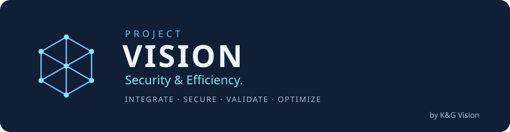

# Project Vision

**Security & Efficiency · Segurança e Eficiência.**  
*Independent AI research and engineering · by K&G Vision*

Integrate · Secure · Validate · Optimize

[Project website](https://kgasil.github.io/vision/) · [Português](#português) · [English](#english)

## English

Project Vision is the research and engineering branch of K&G Vision, an independent technology initiative. We explore vendor-neutral AI integration, security, assurance, governance and performance.

### Technology laboratory

| Engine | Demonstration |
| --- | --- |
| K&G AI Shield | Sensitive-data masking and heuristic security indicators |
| K&G AI Gateway | Simulated model-profile selection |
| K&G AI Assurance | Structured comparison against supplied references |
| K&G AI Performance | Illustrative cost, latency and caching estimates |
| K&G AI Sentinel | Synthetic telemetry and security signals |
| K&G AI Connect | Integration design, permissions and controls |

The laboratory also includes an integrated enterprise simulation, Intelligence Studio, Trust Center, Research Center and Knowledge Center.

**Current baseline:** V10.2 Launch Quality Edition, migrated to the Project Vision identity. The previous release documented 101 internal checks. The technical baseline was migrated to the current identity. Subsequent changes include ecosystem navigation and descriptive text. The 101 checks belong to the earlier revision; current browser regression tests have not been rerun.

All current demonstrations run locally in the browser using synthetic or user-supplied inputs. They are educational prototypes, not production security products, live provider integrations or independent audits. Do not submit sensitive real-world data.

### Run locally

Open `index.html` in a browser, or serve the repository root with a local static HTTP server. No build step is required.

## Português

O Project Vision é a frente de pesquisa e engenharia da K&G Vision, uma iniciativa tecnológica independente. Nosso foco é integração de IA, segurança, avaliação, governança e desempenho, sem dependência de um único fornecedor.

O laboratório reúne seis motores demonstrativos, onze demonstrações locais, guias técnicos, pesquisas, uma plataforma integrada, Trust Center e Intelligence Studio.

A base V10.2 foi preservada durante a migração de identidade. As 101 verificações internas pertencem à revisão anterior; os testes de regressão no navegador ainda precisam ser reexecutados nesta versão.

Os recursos atuais são protótipos educacionais, não serviços empresariais em produção. Não insira informações sensíveis reais.

### Executar localmente

Abra `index.html` no navegador ou utilize um servidor HTTP estático local. Não é necessário compilar.

## Ecosystem / Ecossistema

| Project | Website | Repository | Current stage / Etapa atual |
| --- | --- | --- | --- |
| K&G Vision | [Institutional](https://kgasil.github.io/) | [Source](https://github.com/Kgasil/kgasil.github.io) | Independent initiative / Iniciativa independente |
| Project Genesis | [Sabedoria e Aplicação](https://kgasil.github.io/genesis/) | [Source](https://github.com/Kgasil/genesis) | Independent studies; 10 review guides planned, none published / Estudos independentes; 10 guias previstos, nenhum publicado |
| Project Vision | [Security & Efficiency](https://kgasil.github.io/vision/) | [Source](https://github.com/Kgasil/vision) | Local demonstration lab / Laboratório demonstrativo local |
| Project Aeris | [Discreet & Efficient. / Discreto e Eficiente.](https://kgasil.github.io/aeris/) | [Source](https://github.com/Kgasil/aeris) | Product concept; no downloadable release / Conceito de produto; sem versão para download |
| Project Lilium | [Where strategy meets intelligence.](https://kgasil.github.io/lilium/) | [Source](https://github.com/Kgasil/lilium) | Local metrics prototype; business suite planned / Protótipo local de indicadores; aplicação empresarial em planejamento |

**Learn · Build · Simplify · Transform / Aprender · Construir · Simplificar · Transformar**

## Repository

- `index.html` — bilingual static website and demonstration engines.
- `assets/brand-banner.svg` — project brand banner.

License: not yet specified. Public visibility does not grant permission to reuse or redistribute code.

Contact: [LinkedIn](https://www.linkedin.com/in/kaio-gabriel-da-silva) · [GitHub](https://github.com/Kgasil)

## Identidade K&G Vision / K&G Vision identity

[Versão vertical / Vertical lockup](https://github.com/Kgasil/kgasil.github.io/blob/main/assets/brand-stacked.svg) · [Escudo / Shield](https://github.com/Kgasil/kgasil.github.io/blob/main/assets/kg-symbol.svg)

Official visual lockup: **K&G** above **Vision**; individual project symbols are retained. / Assinatura visual oficial: **K&G** acima de **Vision**, mantendo os símbolos individuais dos projetos.

**Genesis (purple) · Vision (blue) · Aeris (green) · Lilium (rose)**

[Experimentar Lilium Insights / Try Lilium Insights (PT-BR)](https://kgasil.github.io/lilium/demo.html) — local prototype, no connected AI or commercial offering.
