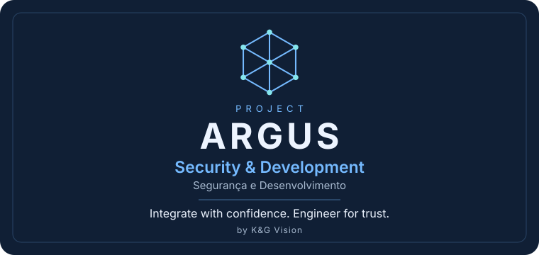

# Project Argus

> Formerly Project Vision / Anteriormente Project Vision. The public identity and canonical repository are now Argus. / A identidade pública e o repositório canônico agora são Argus.

**Security and Development · Segurança e Desenvolvimento.**  
*Independent AI research and engineering · by K&G Vision*

*Integrate with confidence. Engineer for trust.*

Integrate · Secure · Validate · Optimize

[Project website](https://kgasil.github.io/argus/) · [Português](#português) · [English](#english)

> **Marco 1.0 — Laboratório público de pesquisa / Public research lab.** Base técnica V10.2 Launch Quality Edition preservada; demonstrações locais de integração, segurança, avaliação e desempenho de IA. Não é uma versão de produção nem certificação independente.

**Papel no ecossistema / Ecosystem role:** No ecossistema K&G Vision, o Argus explora como tornar integrações de IA mais seguras, confiáveis e responsáveis. / Within the K&G Vision ecosystem, Argus explores more secure, reliable and responsible AI integrations.

## Argus Mini — amostras gratuitas / free samples (0.1.0)

| Amostra / Sample | Funcionalidades / Features | Acesso / Access |
| --- | --- | --- |
| **Mini Lab** | Mascaramento de padrões de dados, revisão heurística de prompts, cobertura de critérios textuais / Data-pattern masking, heuristic prompt review, textual criteria coverage | [Aplicativo web / Web app](https://kgasil.github.io/argus/mini/) |
| **Mini Extension** | Revisão manual de textos e prompts, sem permissões declaradas / Manual text and prompt review, no declared permissions | [Tutorial e código / Tutorial and source](extension/README.md) |

Amostras complementares gratuitas 0.1.0, adicionadas apenas para visitantes conhecerem funcionalidades básicas. Não inauguram um novo marco nem alteram o marco original do projeto ou a base técnica V10.2. Processamento local com regras determinísticas, sem IA conectada, conta, telemetria, armazenamento persistente ou integração empresarial. Use dados fictícios; não substituem DLP, avaliação factual ou controles empresariais. Interface em português. Extensão para instalação manual, não publicada em lojas; validação manual de navegadores pendente.

Free complementary 0.1.0 samples for visitors to explore basic features. They do not inaugurate a new milestone or change the original project milestone or V10.2 technical baseline. Local deterministic processing, no connected AI, account, telemetry, persistent storage or enterprise integration. Synthetic data only; not a substitute for DLP, factual verification or enterprise controls. Portuguese preview UI. Manual extension installation; browser acceptance pending, not in stores.

**Validation / Validação:** 23 deterministic rule checks in `tests/mini.test.js`; run `node tests/mini.test.js`. [CI workflow](https://github.com/Kgasil/argus/actions/workflows/mini-validation.yml).

### Instalação da extensão / Extension installation

[**Baixar Argus Mini v0.1.0 (.zip)**](https://github.com/Kgasil/argus/raw/refs/heads/main/downloads/Argus-Mini-v0.1.0-install.zip) · [Tutorial no site / Website guide](https://kgasil.github.io/argus/#instalar-extensao) · [Código-fonte](extension/README.md)

1. Baixe o [ZIP de instalação v0.1.0](https://github.com/Kgasil/argus/raw/refs/heads/main/downloads/Argus-Mini-v0.1.0-install.zip) e extraia em uma pasta permanente.
2. No Chrome, abra `chrome://extensions/`; no Edge, `edge://extensions/`.
3. Ative o modo desenvolvedor, se permitido, e clique em **Carregar sem compactação** (Load unpacked).
4. Selecione a pasta extraída que contém diretamente `manifest.json` (não o ZIP).
5. Abra Argus Mini no menu de extensões; fixe o ícone se desejar. Clique em Exemplo fictício e teste Privacidade ou Revisão de prompt.

Para atualizar, extraia a nova versão na mesma pasta e clique em Recarregar no gerenciador de extensões. Para remover, clique em Remover. Não contorne políticas administrativas. Validação manual ainda pendente; não disponível nas lojas.

**English:** Extract the installation ZIP. Open `chrome://extensions/` or `edge://extensions/`, enable Developer mode where permitted, select Load unpacked, then select the folder containing manifest.json. Open Argus Mini and try the synthetic example. Reload after replacing files to update; Remove to uninstall. Manual browser acceptance pending; not in stores.

## English

Project Argus is the applied AI research and engineering branch of K&G Vision. Our ambition is to make AI integration more secure, reliable and efficient through vendor-neutral research into cybersecurity, assurance, governance and performance. Explore the local laboratory to understand, test and challenge engineering concepts.

### Technology laboratory

| Engine | Demonstration |
| --- | --- |
| K&G AI Shield | Sensitive-data masking and heuristic security indicators |
| K&G AI Gateway | Simulated model-profile selection |
| K&G AI Assurance | Structured comparison against supplied references |
| K&G AI Performance | Illustrative cost, latency and caching estimates |
| K&G AI Sentinel | Synthetic telemetry and security signals |
| K&G AI Connect | Integration design, permissions and controls |

The laboratory also includes an integrated enterprise simulation, Intelligence Studio, Trust Center, Research Center and Knowledge Center.

**Current baseline:** V10.2 Launch Quality Edition, migrated to the Project Argus identity. The previous release documented 101 internal checks. The technical baseline was migrated to the current identity. Subsequent changes include ecosystem navigation and descriptive text. The 101 checks belong to the earlier revision; current browser regression tests have not been rerun.

All current demonstrations run locally in the browser using synthetic or user-supplied inputs. They are educational prototypes, not production security products, live provider integrations or independent audits. Do not submit sensitive real-world data.

### Run locally

Open `index.html` in a browser, or serve the repository root with a local static HTTP server. No build step is required.

## Português

O Project Argus é a frente de pesquisa e engenharia da K&G Vision, uma iniciativa tecnológica independente. Nosso foco é integração de IA, segurança, avaliação, governança e desempenho, sem dependência de um único fornecedor.

O laboratório reúne seis motores demonstrativos, onze demonstrações locais, guias técnicos, pesquisas, uma plataforma integrada, Trust Center e Intelligence Studio.

A base V10.2 foi preservada durante a migração de identidade. As 101 verificações internas pertencem à revisão anterior; os testes de regressão no navegador ainda precisam ser reexecutados nesta versão.

Os recursos atuais são protótipos educacionais, não serviços empresariais em produção. Não insira informações sensíveis reais.

### Executar localmente

Abra `index.html` no navegador ou utilize um servidor HTTP estático local. Não é necessário compilar.

## GRAAL — Ecosystem / Ecossistema · Marco 01

| Project | Website | Repository | Current stage / Etapa atual |
| --- | --- | --- | --- |
| K&G Vision | [Institutional](https://kgasil.github.io/) | [Source](https://github.com/Kgasil/kgasil.github.io) | Independent initiative / Iniciativa independente |
| Project Genesis | [Wisdom & Application / Sabedoria e Aplicação](https://kgasil.github.io/genesis/) | [Source](https://github.com/Kgasil/genesis) | **1.0 — Editorial & Library / Acervo e biblioteca.** 75 private study PDFs; [public interactive library](https://kgasil.github.io/genesis/biblioteca.html) / 75 PDFs privados; biblioteca pública interativa, sem cursos ou certificados. · [Genesis Mini — complemento gratuito](https://kgasil.github.io/genesis/mini/) · [Instalar extensão / Install extension](https://kgasil.github.io/genesis/#instalar-extensao) |
| Project Rubedo | [Science & Innovation / Ciência e Inovação](https://kgasil.github.io/rubedo/) | [Source](https://github.com/Kgasil/rubedo) | **Marco 01 — Public Lab 1.0.** [Research Workspace 0.3.0](https://kgasil.github.io/rubedo/research/) · [Mini Lab 0.3.0](https://kgasil.github.io/rubedo/mini/) · [Instalação manual / Manual installation](https://kgasil.github.io/rubedo/#instalar); experimental, no store distribution. |
| Project Argus | [Security & Development / Segurança e Desenvolvimento](https://kgasil.github.io/argus/) | [Source](https://github.com/Kgasil/argus) | **1.0 — Public Research Lab / Laboratório público.** Technical baseline V10.2; local demonstrations / Base técnica V10.2; demonstrações locais, não serviços de produção. [Argus Mini — amostra complementar / complementary sample](https://kgasil.github.io/argus/mini/), v0.1.0; original milestone unchanged / marco original preservado. · [Instalar extensão / Install extension](https://kgasil.github.io/argus/#instalar-extensao) |
| Project Aeris | [Efficiency & Simplicity / Eficiência e Simplicidade](https://kgasil.github.io/aeris/) | [Source](https://github.com/Kgasil/aeris) | **1.0 — Extension 1.0.0.** [Manual installation / Instalação manual](https://github.com/Kgasil/aeris/tree/main/extension); Desktop 1.0.0rc1 remains a preview / permanece em prévia. |
| Project Lilium | [Strategy & Growth / Estratégia e Crescimento](https://kgasil.github.io/lilium/) | [Source](https://github.com/Kgasil/lilium) | **1.0 — Web Lab.** Public demo / demonstração pública; Desktop v0.14.0 controlled preview / prévia controlada; [Mini v0.1.1](https://github.com/Kgasil/lilium/tree/main/extension) experimental. |

**Version note / Nota de versão:** 1.0 identifies the first completed public-facing project milestone of the ecosystem, not a uniform software release tag. Genesis is an editorial milestone; Argus retains technical baseline V10.2; Aeris 1.0.0 applies to Extension; Lilium 1.0 applies to Web Lab. / 1.0 identifica o primeiro marco público do ecossistema, não uma tag de software uniforme. Genesis é um marco editorial; Argus mantém a base V10.2; Aeris 1.0.0 refere-se à extensão; Lilium 1.0 refere-se ao Web Lab. Desktop previews are not stable releases / Prévias Desktop não são versões estáveis.

**Learn · Discover · Build · Simplify · Transform / Aprender · Descobrir · Construir · Simplificar · Transformar**

## Repository

- `index.html` — bilingual static website and demonstration engines.
- `assets/brand-banner.svg` — project brand banner.

License: not yet specified. Public visibility does not grant permission to reuse or redistribute code.

Contact: [LinkedIn](https://www.linkedin.com/in/kaio-gabriel-da-silva) · [GitHub](https://github.com/Kgasil)

## Identidade K&G Vision / K&G Vision identity

[Versão vertical / Vertical lockup](https://github.com/Kgasil/kgasil.github.io/blob/main/assets/brand-stacked.svg) · [Escudo / Shield](https://github.com/Kgasil/kgasil.github.io/blob/main/assets/kg-symbol.svg)

Official visual lockup: **K&G** above **Vision**; individual project symbols are retained. / Assinatura visual oficial: **K&G** acima de **Vision**, mantendo os símbolos individuais dos projetos.

**Genesis (purple) · Rubedo (orange/gold) · Argus (blue) · Aeris (green) · Lilium (rose)**

O escudo institucional preserva as quatro cores laterais e o núcleo branco; Rubedo ocupa apenas as pontas centrais superior (laranja) e inferior (dourado). / The institutional shield preserves its four side colors and white core; Rubedo occupies only the upper (orange) and lower (gold) central tips.

[Lilium Interactive Lab / Laboratório interativo](https://kgasil.github.io/lilium/#lab) · [Insights CSV demo](https://kgasil.github.io/lilium/demo.html) — browser-based synthetic exercises; no connected AI or commercial offering.

**Lilium Mini v0.1.1 — GitHub-only / exclusivamente pelo GitHub:** [Installation tutorial / Tutorial de instalação](https://github.com/Kgasil/lilium/tree/main/extension) · Chrome & Edge, manual installation with synthetic data / instalação manual com dados fictícios. Not published in extension stores / não publicado nas lojas.

**25 NOV 2026 — Lilium Web Lab 1.0:** [Comunicado / Announcement](https://github.com/Kgasil/lilium/blob/main/docs/web-lab-v1.0.md) · Public browser demonstrations / Demonstrações públicas no navegador. Desktop v0.14.0 remains a controlled preview / continua em prévia controlada.

**Aeris Extension 1.0.0** — 16 ferramentas, 50 testes automatizados aprovados; instalação manual disponível pelo GitHub. / 16 tools, 50 automated tests passed; manual installation available on GitHub. [Instalação / Installation](https://kgasil.github.io/aeris/extension-preview.html) · [Notas / Release notes](https://github.com/Kgasil/aeris/blob/main/release/extension-1.0.0-notes.md).

 **GRAAL · Marco 01** — identidade integrada / integrated identity.
